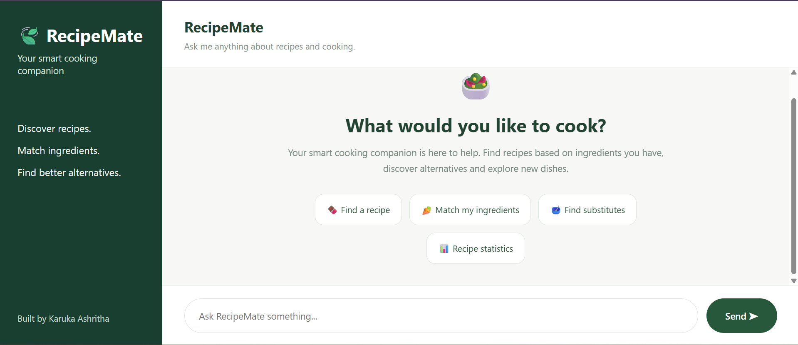

# 🍃 RecipeMate – AI-Powered Conversational Recipe Discovery and Recommendation System

RecipeMate is an AI-powered conversational recipe chatbot that helps users discover recipes, find dishes based on available ingredients, explore cooking instructions, and identify possible ingredient substitutions.

It uses a recipe dataset, semantic search, FAISS vector indexing, and conversational context to provide relevant recipe recommendations.

## 🖥️ Application Preview



## ✨ Features

- **Recipe Discovery:** Search for recipes using dish names and natural-language queries.
- **Ingredient-Based Recommendations:** Find recipes based on ingredients available to the user.
- **Ingredient Restrictions:** Filter recipes using specified dietary keywords and restrictions.
- **Conversational Follow-ups:** Ask additional questions about previously retrieved recipes.
- **Cooking Information:** Retrieve relevant cooking instructions and preparation details.
- **Ingredient Substitutions:** Explore possible substitutions supported by evidence from the recipe dataset.
- **Recipe Statistics:** Explore dataset statistics, including common ingredients and ingredient counts.
- **No-Match Handling:** Provides a fallback response when relevant results cannot be found.

## 🛠️ Technologies Used

- Python
- Google Colab
- Sentence Transformers
- all-MiniLM-L6-v2
- FAISS
- NumPy
- Pandas
- Flask
- HTML, CSS and JavaScript
- Gemini API (for comparison experiments)

## 🧠 System Architecture

RecipeMate follows a retrieval-based architecture:

1. **Dataset Loading:** Loads and processes recipe records from the Recipe Box dataset.
2. **Preprocessing:** Cleans recipe information and normalizes ingredient names.
3. **Embedding Generation:** Generates 384-dimensional sentence embeddings using all-MiniLM-L6-v2.
4. **Vector Indexing:** Uses FAISS with normalized embeddings for similarity-based retrieval.
5. **Recipe Retrieval:** Retrieves relevant recipes based on user queries.
6. **Response Generation:** Processes user questions and retrieved recipe information to provide relevant responses.
7. **Web Interface:** Uses Flask to connect the chatbot backend with the RecipeMate interface.

## 📊 Dataset

The project uses the Recipe Box dataset containing three JSON files.

- Total recipes loaded: 125,164
- Valid recipes with titles and ingredients: 122,971
- Embedding model: all-MiniLM-L6-v2
- Embedding dimension: 384
- Vector search: FAISS IndexFlatIP

Recipe information includes titles, ingredients, cooking instructions, and associated metadata.

## 📁 Project Structure

```text
RecipeMate/
│
├── Recipe_Chatbot_GenAI_Assignment.ipynb
├── recipemate_clean.py
├── index.html
├── README.md
│
└── Screenshots/
```

## 🚀 How to Run

1. Clone or download this repository.
2. Open the Jupyter notebook in Google Colab.
3. Upload the Recipe Box dataset files as required by the notebook.
4. Install the required Python libraries.
5. Run the preprocessing and embedding-generation steps.
6. Generate or load the FAISS index and processed recipe files.
7. Initialize the chatbot backend.
8. Start the Flask application.
9. Open the generated application URL to interact with RecipeMate.

**Note:** The processed recipe files, embeddings, and FAISS index are not included in this repository because of their size. They must be generated from the dataset or restored from the corresponding saved files before running the application. Some experimental cells may also require a Gemini API key, which should be configured securely through Colab Secrets.

## 🧪 Evaluation

The chatbot was tested using different conversational scenarios, including:

- Recipe search queries.
- Follow-up questions about cooking instructions.
- Ingredient-based recipe recommendations.
- Queries with dietary restrictions.
- Queries with no matching ingredients.
- Recipe statistics.
- Ingredient substitution queries with and without supporting evidence.

A comparison with a one-shot LLM response was also performed to examine the importance of grounding answers in the available recipe dataset.

## ⚠️ Limitations

- Ingredient restriction filtering is keyword-based and is not a guarantee of allergy safety.
- Substitution recommendations depend on evidence available in the dataset.
- Some recipes may have incomplete ingredient or instruction information.
- The application currently runs through a Flask server started in Google Colab; a permanent public deployment is not included.

## Deployment Status

The RecipeMate application was developed and tested using Google Colab and the full Recipe Box dataset.

A separate deployment-ready version containing approximately 15,000 recipes was prepared to reduce memory requirements. The Flask application and supporting files were also configured for deployment on Render.

However, the deployment could not be completed because the application exceeded the memory limit of Render's free tier.

The original Colab implementation and full dataset remain preserved. The application can be run locally or through Google Colab by following the setup instructions above.

The reduced dataset is intended for deployment testing and does not replace the full dataset used in the original project.

## 👩‍💻 Author

**Karuka Ashritha**

GitHub: [@ashritha-r](https://github.com/ashritha-r)

---

*Developed as part of a Gen AI Internship Assignment.*
